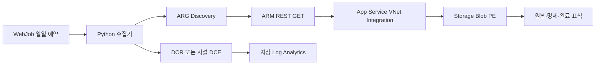
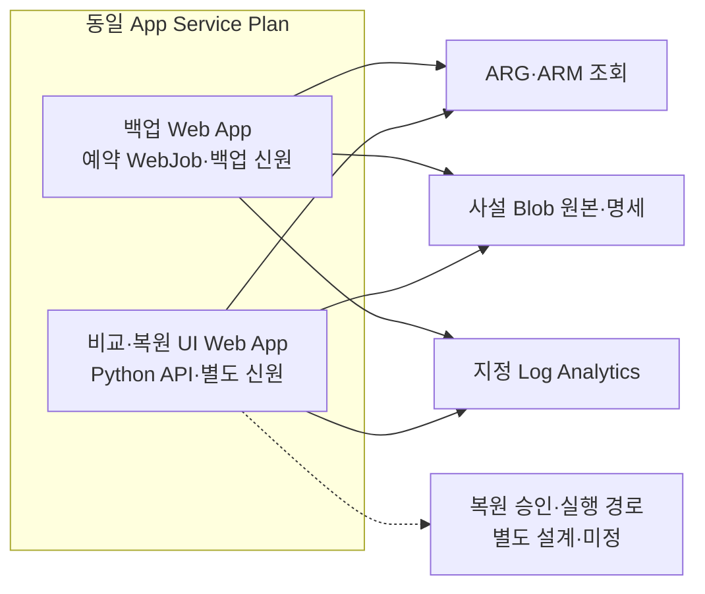

# 아키텍처와 백업의 보장 범위

> 범위: Discovery·REST 수집·사설 Blob·Log Analytics 실행 경로와 실패/완료 계약.

**한 줄 요약** — 저장된 원본과 수집 완료는 보장 대상으로 삼되, 모든 관리 설정의 수집이나 자동 복원을 과장하지 않는다.

## 구성



*그림: 구현된 수집·보관·로그 흐름. ARG·ARM·인증 출구와 DCE 사설 경로는 별도로 허용해야 한다. (근거: [수집기](../src/armbackup/backup.py), [로그 계약](../src/armbackup/events.py), [VNet Integration](https://learn.microsoft.com/azure/app-service/overview-vnet-integration), [Logs Ingestion](https://learn.microsoft.com/azure/azure-monitor/logs/logs-ingestion-api-overview))*

App Service의 Private Endpoint는 **인바운드**, VNet Integration은 **아웃바운드**다. 전자는 Blob 접근을 대체하지 않는다. 관리·배포 접점인 SCM을 private-only로 쓰면 사설 DNS·배포 에이전트 경로도 준비한다. (근거: [App Service PE](https://learn.microsoft.com/azure/app-service/networking/private-endpoint))

## 추가 결정 — 비교/복원 UI도 동일 App Service Plan 사용

사용자 결정은 **UI의 App Service 호스팅과 백업 실행기와 동일한 App Service Plan 이용**이다. 비교 엔진·단일 운영자 LAB 호스팅·안전 복원 실행기는 구현했으며 [배포 문서](deployment.md)를 따른다. 아래의 **별도 Web App·관리 ID 분리는 운영 권장 구성**이며 현재 단일 앱 LAB 토폴로지를 뜻하지 않는다.



*그림: 같은 Plan에 UI를 호스팅한다는 확정 요구와 앱/신원을 분리하는 권장안. 화살표는 논리적 접근이며 실제 UI·네트워크·권한을 배포했다는 뜻이 아니다. (근거: 사용자 결정, [Plan 자원 공유](https://learn.microsoft.com/azure/app-service/overview-hosting-plans), [UI 설계](comparison-ui.md))*

Plan 공유는 컴퓨트·스케일 공유이지 앱별 성능/장애 격리가 아니다. UI와 백업 앱의 VNet Integration·DNS·인증/RBAC는 각각 확인한다. 현재 행 음영은 최신 백업 상태이며 형상 Diff·조회 오류와 구분한다. [상세 UI 요구](comparison-ui.md)와 [배포 조건](deployment.md)을 따른다.

## Discovery 계약

- ARM `/subscriptions`를 순회해 접근 가능한 Enabled 구독을 확인한다. `subscriptions`가 비어 있으면 그 범위 전체를 사용한다.
- 구독을 명시했는데 신원이 접근하지 못하거나 Enabled가 아니면 실패한다. 자동 탐색에서 제외된 상태의 구독은 명세에 기록한다.
- 네 테이블을 구독별로 조회한다. AuthorizationResources는 role assignment/definition, PolicyResources는 assignment/definition/set/exemption만 선택하고 평가 이벤트는 제외한다.
- `id` 순서·1,000건 페이지·`$skipToken`을 사용한다. 반복 토큰·중복 ID·조회 중 총수 변경·잘린 결과를 실패 처리한다.
- ResourceContainers를 조회한다면 각 구독 컨테이너가 있는지도 검사한다.
- 다른 테이블에서 같은 ID가 나오면 유형 일치 확인 후 중복 제거한다.

ARG는 비동기 색인이며 지원 유형과 PII 제거의 제약이 있다. **원자적 시점 스냅샷, 최근 변경의 즉시 반영, 신원에 보이지 않는 자원의 존재를 보증하지 않는다.** 관리그룹/테넌트 수준 정책·상속 객체·Entra 데이터는 이 구현의 자동 탐색 범위가 아니다. (근거: [ARG 개요](https://learn.microsoft.com/azure/governance/resource-graph/overview), [지원 유형](https://learn.microsoft.com/azure/governance/resource-graph/reference/supported-tables-resources), [페이지네이션](https://learn.microsoft.com/azure/governance/resource-graph/concepts/work-with-data))

## 상세 수집 계약

GET은 ARG 행이 아니라 실제 리소스 ID에 보낸다. API는 명시 override 또는 유형별 provider metadata의 안정 버전에서 선택한다. `sourceKind`, `captureApiVersion`, 수집 시각, 원본 응답과 보완 수집 응답을 보존한다.

**GET 하나는 해당 서비스 전체 형상이 아니다.** App Service 앱 설정·Key Vault 비밀값·AKS 내부 Kubernetes 객체·DB 데이터·VM OS/파일·데이터 평면 설정 등은 자동 백업하지 않는다. GET 자식/list는 선언한 프로필만 추가한다. `listKeys`·비밀 조회·읽기 성격의 POST도 자동으로 실행하지 않는다. 새 유형은 필수 설정과 조회 계약을 검토한 뒤 프로필을 추가한다. 미지원/403/404/버전 검색 실패를 성공으로 바꾸지 않는다.

## Blob 기록 형식

```text
<prefix>/
  locks/capture.lock
  runs/<UTC-run-id>/
    discovery.json
    resources/<resource-id-sha256>.json
    manifest.json
    COMPLETE.json
```

파일 쓰기는 `overwrite=False`다. 하나의 prefix 내 전체 수집을 60초 lease와 20초 갱신으로 직렬화해 겹치는 스코프의 동시 예약을 방지한다. 상이한 앱이라도 동일 container/prefix를 쓰면 같은 lock을 사용한다.

| 상태 | 의미 |
| --- | --- |
| `Captured` | 선언 범위의 Discovery·필수 수집·원본 저장에 실패가 없었음 |
| `Incomplete` | Discovery 또는 개별 필수 수집이 일부 실패했음 |
| `Excluded` | 설정에 명시한 유형 제외 또는 RG 범위 밖; 명세에서 사유 확인 |
| `restoreStatus: Unverified` | 저장은 됐지만 해당 자료의 복구 성공을 증명하지 않았음 |

**운영 완료 조건은 유효한 manifest + `COMPLETE.json`**이다. 필수 수집/파일 저장/로그 전송 실패 시 완료 표식을 만들지 않는다. Discovery 전의 치명적 실패나 저장소 장애라면 manifest도 없을 수 있다. `manifest.status=Captured`만으로 로그 전송 성공을 추정하지 않는다.

SHA-256은 오류·무단 변경 탐지에 도움을 주지만 서명이나 변조 방지 보존 정책을 대신하지 않는다. 원본에는 민감한 구성값이 있을 수 있으므로 Blob 접근·암호화·불변 보존·삭제 분리를 운영자가 설계한다. 쓰기 identity의 기본 Contributor 역할에는 삭제 권한도 포함될 수 있다.

## 로그와 성공의 경계

DCR immutable ID, 입력 schema, stream, destination Workspace, endpoint를 ARM으로 확인하고 변환은 `source`만 허용한다. 다른 Workspace 라우팅·필터링 변환은 거부한다. 실제 전송에는 Logs Ingestion SDK를 사용한다.

**API의 수신 성공은 테이블에서 즉시 조회되거나 영구 보관됐다는 보증은 아니다.** LA 처리 지연·DCR 오류·retention을 따로 감시한다. 원본 설정·비밀·토큰은 로그로 보내지 않는다. 로그의 ResourceId·범위 정보도 내부 정보로 취급한다.

현재는 Azure public cloud 엔드포인트만 지원하며 sovereign cloud는 지원하지 않는다. 재실행·중복·장애 복구와 복원 범위는 [운영](operations.md)·[복원](restore.md)을 따른다.
