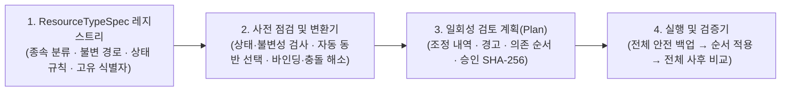

# 복원·복제 코어 엔진 및 사용자 인터페이스 설계 명세

> 범위: Azure 제어 평면(Control Plane) 형상 백업·복원·복제의 공통 의미 규칙, 리소스 종류별 고유 제약, 확장 가능한 코어 아키텍처, 오류 예방 중심 사용자 인터페이스 계약.
> 현재 공식 지원: **Standard Load Balancer**, **Application Gateway (WAF_v2)** 및 동반 리소스(`Public IP`, `Backend Pool`, `WAF Policy`, 공유 `VNet/Subnet`).
> 차기 로드맵 설계 반영: **Virtual Machine (VM)**, **Virtual Machine Scale Set (VMSS)** 및 동반 리소스(`Network Interface`, `Managed Disk`, `Extension`, 공유 `Availability Set`·`Proximity Placement Group`·`Image`·`Key Vault`).

**한 줄 요약** — ARM 원본 응답(raw JSON)을 그대로 다시 `PUT`하지 않고, **① 리소스 종속·노출 관계 6분류**, **② 상태 의존·생성 후 불변 속성 5등급**, **③ 복제 고유 충돌·바인딩 규칙**을 선언형 리소스 명세(`ResourceTypeSpec`)로 모델링하여 코어 엔진과 UI가 실행 전에 오류 원인을 자동으로 해소하거나 안내한다.

---

## 1. 왜 단순 ARM JSON 재전송(`PUT`)은 실패하는가

백업 시점에 `ARM GET`으로 수집한 원본 응답에는 읽기 전용 계산값, 다른 리소스가 소유한 역참조, 생성 시점에만 정할 수 있는 불변 속성, 리전·서브넷 전체에서 유일해야 하는 식별자, 특정 런타임 상태에서만 바꿀 수 있는 속성이 섞여 있다. 이를 구분하지 않고 복원·복제하면 다음 세 가지 범주에서 반복적인 오류가 발생한다.

1. **종속 관계와 노출 계층 불일치:** 부모 본문 안의 인라인 설정, 리소스 그룹(RG)에는 보이지 않지만 별도 하위 `PUT`이 필요한 자식 리소스, RG에 노출되지만 한 곳에만 연결할 수 있는 배타 리소스, 여러 리소스가 공유하는 정책·네트워크 인프라의 수명주기가 서로 다르다.
2. **생성 후 불변 속성 및 런타임 상태 제약:** 생성 이후 절대 바꿀 수 없는 속성(`location`, `zones`, `sku` 등)과 특정 상태(`Stopped`, `Stopped (deallocated)`, `Disassociated` 등)에서만 변경 가능한 속성이 존재하며, 반대로 중지된 리소스에 `PUT`을 보내면 의도치 않게 서비스가 시작되기도 한다.
3. **복제(Clone) 시 고유성·참조 경계 충돌:** 새 리소스 ID로 생성하더라도 리전 고유 DNS 레이블(`domainNameLabel`), 서브넷 내 정적 사설 IP, 1:1 결합 리소스(`Public IP`, `NIC`, `OS Disk`) 공유 불가, 구독·리전 경계를 넘는 `Subnet`/`VNet` 참조 불가, 복제할 수 없는 하위 멤버(NIC 역참조, 피어링) 때문에 그대로 생성할 수 없다.

본 문서는 이 세 가지 문제를 코어 엔진과 사용자 인터페이스에서 일관되게 다루기 위한 정본 설계다.

---

## 2. 리소스 종속 관계 및 노출 계층 6분류 체계

Azure 리소스 간 관계는 **(a) 사용자 노출 여부**, **(b) 리소스 그룹(RG) 상단 목록 노출 여부**, **(c) 수명주기 귀속과 공유 가능성**의 세 축에 따라 아래 6가지 분류(`RelationClass`)로 정의한다. 코어 엔진(`resource_bundles.py`, `azure_semantics.py`)과 UI(`bundle-panel.mjs`)는 모든 관계를 이 분류로 해석한다.

| 분류 코드 | RG 목록 노출 | 사용자 노출 위치 | 대표 예시 (현재 · 로드맵) | 백업 수집 동작 | 복원 (`Update` / `Create`) 동작 | 복제 (`Clone`) 동작 |
| --- | --- | --- | --- | --- | --- | --- |
| **`inline`** 부모 내장 구성 | 미노출 | 부모 리소스 설정 화면 내부 | LB `frontendIPConfigurations`·`rules`·`probes`, AGW `listeners`·`routingRules`·`backendPools`·`probes`, VNet `subnets`, VM `dataDisks` 슬롯, VMSS `virtualMachineProfile` | 부모 단일 `GET`에 포함 | 부모 `PUT`으로 원자적 교체. 백업 이후 추가된 사용 중 항목의 암묵 삭제 여부 사전 검사 | 부모 복제본에 포함. 본문 내부 자기참조 ARM ID(`.../parent/child`)를 새 부모 ID로 자동 재작성 |
| **`contained`** 부모 귀속 하위 리소스 | 미노출 | 부모 리소스 블레이드 내부 (독립 ARM 하위 경로 보유) | LB `backendAddressPools`(명시적 IP 멤버 관리), Front Door `afdEndpoints`·`routes`·`origins`, 차후 VM/VMSS `extensions` | 부모 선택 시 하위 목록·상세를 자동 동시 수집(누락 시 완료 표식 거부) | 부모 선택 시 항상 자동 포함(개별 체크 해제 불가). 부모 `PUT` 직후 하위 엔드포인트 후속 `PUT` | 부모와 항상 새 하위 ID로 동반 생성(단독 복제 금지). 복제 불가 멤버는 비운 상태로 초기화 |
| **`exclusive`** 전용 결합 일반 리소스 | **노출** | RG 리소스 목록 및 부모 참조 필드 (1:1 배타 결합) | `Public IP` (`ipConfiguration` 단일 연결), 차후 VM `Network Interface`, 비공유 `Managed Disk` (`maxShares <= 1`) | 주 대상 참조 탐색으로 자동 동시 수집 | 기본은 주 대상만 복원(기존 리소스 연결 유지) 또는 선택 시 형상까지 함께 복원 | 원본과 동시 연결 불가 → **복제 모드에서 자동 동반 복제(필수 잠금)** 및 새 ARM ID로 참조 자동 교체 |
| **`shareable`** 공유 가능 연관 리소스 | **노출** | RG 리소스 목록 (N:1 다중 참조 가능) | AGW `WAF Policy`, 차후 `NSG`, `Route Table`, `User-Assigned Identity`, `Proximity Placement Group` | 주 대상 참조 탐색으로 자동 동시 수집 | 선택 시 함께 복원, 해제 시 기존 공유 리소스를 읽기 전용 검증만 수행 | 동일 구독·동일 리전이면 **[함께 복제 / 기존 리소스 공유]** 선택 허용. **타 구독·타 리전 복제 시 자동 동반 복제(잠금)** |
| **`shared-infra`** 기반 인프라 경계 | **노출** | RG 리소스 목록 (상위 네트워크·보안·이미지 기반) | `VNet / Subnet`, 차후 `Key Vault`, `Compute Gallery / Image`, `Availability Set`, `DiskEncryptionSet` | 주 대상 백업이 소유하지 않음 (참조 ID만 보존) | 절대 덮어쓰지 않음. 존재 여부·`Succeeded` 상태·지문 불변만 읽기 전용 검증 | 덮어쓰기·자동 복제 금지. 동일 구독·리전은 원본 공유 가능, 타 구독·타 리전·타 망은 **대상 인프라 바인딩(`referenceBindings`)** 으로 재연결 |
| **`excluded`** 비소유 역참조·외부 대상 | 미노출 또는 외부 | 타 리소스 소유 속성 또는 비-ARM 주소 | LB 풀의 `backendIPConfigurations`(NIC 소유 역참조), VNet `peerings`, Subnet `ipConfigurations`, 순수 IP/FQDN 문자열 백엔드 | 원본(`raw`)에는 보존하되 복구 투영에서 분리 | `PUT` 본문에서 제거(`dropped`). NIC 연결은 NIC가 소유하므로 건드리지 않음; 주소 대상은 수동 검증 안내 | `PUT` 본문에서 제거(`dropped`). LB 복제 풀은 빈 풀로 생성하여 원본 NIC 연결을 보호 |

### 종속 순서(Topological Order) 원칙

1. **참조 대상 우선 생성·갱신:** `exclusive` 및 선택된 `shareable` 리소스(`Public IP`, `WAF Policy`, 차후 `Managed Disk` → `NIC`)를 주 리소스(`LB`, `AGW`, 차후 `VM`/`VMSS`)보다 먼저 `PUT`하고 `provisioningState == Succeeded`를 확인한다.
2. **부모 적용 후 `contained` 자식 적용:** `LB` 부모 `PUT`이 만든 빈 백엔드 풀 플레이스홀더의 지문을 확인한 뒤 `LB_POOL` 자식 `PUT`으로 IP 백엔드 멤버를 채운다(차후 `VM` 본체 `PUT` 완료 후 `VM Extension` 자식 `PUT`과 동일 패턴).
3. **교차 자식 준비 순서:** Front Door `Route`처럼 다른 형제 자식(`Origin`, `Rule`)의 활성 상태를 요구하는 경우 구성 의존 간선(`configuration`)에 따라 피참조 자식을 먼저 적용한다.

---

## 3. 속성 변경 가능성 5등급 및 리소스 상태 제약 모델

복원(`Update`)과 복제(`Clone`) 시 속성을 무작정 보내지 않도록 모든 필드를 **변경 가능성 5등급(`M0`~`M4`)** 으로 분류하고, 대상 리소스의 **현재 상태(프로비저닝·운영·연결·전원 상태)** 와 교차 검증한다.

### 3.1 속성 변경 가능성 5등급

| 등급 | 명칭 | 의미 및 예시 | 복원 (`Update`) 처리 | 복제 (`Clone`) / 재생성 (`Create`) 처리 |
| --- | --- | --- | --- | --- |
| **`M0`** | 서버 관리·계산 전용 (`Server-Assigned`) | `id`, `etag`, `type`, `systemData`, `provisioningState`, `resourceGuid`, PIP `ipAddress`·`fqdn`·`ipConfiguration`, AGW `operationalState`·하위 역참조 backlink, 동적 사설 IP의 현재 주소 | `PUT` 본문에서 항상 제거. 사용자 변경 불가 | `PUT` 본문에서 항상 제거. 새 리소스에서 Azure가 새로 배정 |
| **`M1`** | 구조·계열 불변 (`Family Immutable`) | AGW `v1`(`Standard`/`WAF`) ↔ `v2`(`Standard_v2`/`WAF_v2`), 차후 VMSS `orchestrationMode`(`Uniform` ↔ `Flexible`), VM OS `osType`(`Windows` ↔ `Linux`) | 백업과 현재 계열이 다르면 **현재 값 유지(`keep-current`)로도 병합 불가** → 즉시 차단 및 복제/재생성 안내 | 백업 계열 그대로 새 리소스 생성 가능 (단, 단종·미지원 SKU는 프로필 정책 준수) |
| **`M2`** | 생성 후 불변 (`Create-Only Immutable`) | 모든 리소스 `location`·`extendedLocation`, PIP `zones`·`sku.tier`·`publicIPAddressVersion`·`publicIPPrefix`·`ipTags`·불허 SKU 전환(`Standard`→`Basic`, `Standard`↔`Standardv2`), LB `sku.name`·`sku.tier`, AGW `zones`·`enableFips`, 차후 VM `zones`·`availabilitySet`·`computerName`·`adminUsername`, VMSS `platformFaultDomainCount`·`singlePlacementGroup`(`false`→`true`) | 백업과 현재 값이 다르면 사전 감지. 기본(`block`)은 중단하며, **`현재 값 유지(keep-current)`** 선택 시 해당 불변 속성만 현재 값을 유지하고 나머지 설정을 복원(`kept-current` 기록) | 제약 없이 백업 값(또는 복제 시 지정한 새 `location`/오버라이드 값)으로 생성 가능 |
| **`M3`** | 런타임·연결 상태 의존 (`State-Dependent`) | 리소스의 운영 상태(`operationalState`), 연결 상태(`ipConfiguration`, NIC 풀 참조), 전원 할당 상태(`PowerState/deallocated`)에 따라 허용 여부가 달라지거나 상태 전이를 일으키는 속성 | 아래 **§3.2 상태 전이·상태 의존 규칙**으로 사전 판정하여 차단 또는 부작용 경고 표시 | 신규 생성이므로 기존 연결 제약 없음 (단, 대상 서브넷 제약 등은 §4 적용) |
| **`M4`** | 상시 온라인 가변 (`Online Mutable`) | 부하분산 규칙, 프로브, 리스너, 경로 규칙, 백엔드 HTTP 설정, WAF 커스텀/관리형 규칙, 유휴 시간, 태그 등 | 정상 적용. 단, 전체 배열 교체(`PUT`)로 인해 사용 중인 하위 항목이 암묵 삭제되면 사전 차단(`destructive_changes`) | 정상 생성 및 필요 시 사용자 값 변경(`overrides`) 허용 |

### 3.2 제어 평면·런타임·연결 상태별 복원 규칙

1. **제어 평면 프로비저닝 상태 (`properties.provisioningState`)**
   - **전이 중 (`Updating`, `Deleting`, `Creating`):** 진행 중인 ARM 작업과 충돌하므로 백업 수집·복원·복제 대상 쓰기를 모두 즉시 차단하고 완료 후 재시도하도록 안내한다.
   - **실패 (`Failed`, `Canceled`):**
     - *백업 수집 시:* 불완전한 형상이므로 정상 백업 원본으로 채택하지 않는다(`verify_backup_source` 거부).
     - *Update 복원 시:* 최근 잘못된 설정 변경으로 `Failed` 상태에 빠진 리소스에 직전 검증된 백업 형상을 다시 `PUT`하여 목표 상태(Goal State)를 회복하는 것은 핵심 운영 복구 시나리오다([Application Gateway 502 복구 공식 가이드](https://learn.microsoft.com/troubleshoot/azure/application-gateway/troubleshoot-http-502-bad-gateway#resolution-g)). 따라서 전이 중 상태와 분리하여 **Update 복원을 허용**하되 계획에 `현재 Failed 상태 복구 시도` 경고를 명시한다.

2. **Application Gateway 운영 상태 (`properties.operationalState`)**
   - **`Starting` / `Stopping`:** 게이트웨이 시작·중지 전이 중이므로 모든 업데이트를 사전 차단한다.
   - **`Stopped` 상태에서의 `PUT` 자동 시작 부작용:** Azure Application Gateway는 `Stopped` 상태에서 태그·프로브·리스너 등 어떤 `PUT` 요청이든 수신하면 **자동으로 게이트웨이를 `Running` 상태로 시작**하며 과금과 트래픽 처리가 재개된다([Application Gateway FAQ](https://learn.microsoft.com/azure/application-gateway/application-gateway-faq#how-can-i-stop-and-start-application-gateway)). 코어 엔진은 현재 대상이 `Stopped`이면 계획 검토 단계에서 이를 감지해 명확한 경고를 남긴다.
   - **`gatewayIPConfigurations[].subnet.id` 변경 제약:**
     - 다른 VNet으로의 서브넷 변경, 또는 정적 사설 프런트엔드 IP가 설정된 v2 게이트웨이의 서브넷 변경은 상태와 관계없이 **불가(`M2`)** 하다.
     - 동일 VNet 내 다른 서브넷으로의 이동(공용 프런트엔드 전용 v2 등 허용 조건 충족 시)은 게이트웨이가 **`Stopped` 상태일 때만 허용**되며 `Running` 상태에서는 거부된다([Application Gateway 서브넷 변경 FAQ](https://learn.microsoft.com/azure/application-gateway/application-gateway-faq#can-i-change-the-virtual-network-or-subnet-for-an-existing-application-gateway)).

3. **Public IP 연결 상태 (`properties.ipConfiguration` 유무)**
   - 소비 리소스(LB 프런트엔드, AGW 프런트엔드, VM NIC)에 **연결된 상태(`Attached`)** 에서는 `publicIPAllocationMethod`(`Static` → `Dynamic`) 변경과 `Basic` → `Standard` SKU 업그레이드가 불가능하다([Public IP 설정 변경 제약](https://learn.microsoft.com/azure/virtual-network/ip-services/virtual-network-public-ip-address#view-modify-settings-for-or-delete-a-public-ip-address)). 코어 엔진은 `live.properties.ipConfiguration`이 존재할 때 해당 속성이 다르면 연결 해제가 필요함을 알리거나 `keep-current`로 현재 값을 유지한다.

4. **Load Balancer 및 VNet 하위 컬렉션 암묵 삭제 방지 (`destructive_changes`)**
   - ARM `PUT`은 하위 배열 전체를 교체한다.
   - **VNet:** 현재 VNet에 존재하지만 백업 시점에는 없던 서브넷이 삭제될 경우 연결 자원 장애를 막기 위해 사전 차단한다.
   - **Load Balancer:** 현재 LB에 존재하며 **실제 NIC(`backendIPConfigurations`)가 연결되어 사용 중인 백엔드 풀**이 백업본에 없어 삭제되려 할 경우, ARM `InUse` 오류 전에 사전 차단하고 사용 중인 풀 이름을 안내한다.

5. **로드맵 — Virtual Machine / VMSS 전원 및 할당 상태 (`PowerState`)**
   - OS 내부 종료(`PowerState/stopped`)와 Azure 컴퓨트 할당 해제(`PowerState/deallocated`)를 엄격히 구분한다.
   - 실행 중(`running`) 가능한 변경(태그, 확장, 동일 클러스터 내 지원 `vmSize` 변경 — 단 재부팅 발생 경고 필수)과 **`deallocated` 상태 필수 변경**(타 하드웨어 클러스터 `vmSize`, `host`/`hostGroup`/`proximityPlacementGroup`, OS 디스크 및 비온라인 데이터 디스크 크기 확장 — [디스크 크기 조정 오류 가이드](https://learn.microsoft.com/troubleshoot/azure/virtual-machines/windows/troubleshoot-disk-resize))을 분리해 사전 점검한다.

---

## 4. 복제(Clone) 고유 제약과 스마트 충돌 해소 규칙

복제는 원본을 변경하지 않고 다른 리소스 ID(같은 RG의 새 이름, 다른 RG, 다른 구독, 또는 다른 리전)에 새 리소스를 생성한다. 불변 속성 제약은 없으나 다음 **6가지 복제 제약(`C1`~`C6`)** 을 코어 엔진과 UI가 함께 처리한다.

### C1. ARM Resource ID 및 이름 고유성
- **동일 RG 복제:** 원본과 같은 타입·같은 이름을 쓸 수 없으므로 이름 접두사(`clonePrefix`) 또는 리소스별 개별 새 이름(`name`)이 필수다.
- **타 RG / 타 구독 복제:** 대상 RG가 원본 RG와 다르면 접두사 없이 **원본 이름을 그대로 유지**할 수 있다.
- **사전 부재 검증:** 모든 복제 대상 ID(동반 복제 리소스 포함)에 대해 `ARM GET`으로 부재(`missing`)를 확인하며, 하나라도 이미 존재하면 쓰기 전에 어떤 이름이 겹치는지 안내하고 중단한다.

### C2. 전역·리전 고유 식별자 충돌 (`Globally / Regionally Unique`)
- **Public IP `dnsSettings.domainNameLabel`:** `<label>.<location>.cloudapp.azure.com` FQDN을 형성하므로 **같은 리전 안의 모든 테넌트·구독 전체에서 유일**해야 한다([Public IP DNS 레이블 규칙](https://learn.microsoft.com/azure/virtual-network/ip-services/virtual-network-public-ip-address#create-a-public-ip-address)).
  - 접두사가 있으면 `<prefix>-<label>`로 자동 변환한다(소문자·숫자·하이픈, 63자 이내 검증).
  - 다른 RG로 접두사 없이 복제할 때 DNS 레이블이 설정된 공용 IP가 있으면, UI가 `<대상RG>-<원본레이블>` 형태의 안전한 후보값을 자동 제안하고 전용 입력란에서 바로 수정할 수 있게 하여 오류를 예방한다. 서버는 접두사와 명시적 DNS 레이블 지정이 모두 없으면 실행 전 거부한다.
- **Public IP `dnsSettings.reverseFqdn`:** 원본 FQDN 소유권 검증에 묶여 있으므로 명시적으로 새 값을 지정하지 않으면 자동 제외(`dropped`)한다.

### C3. 서브넷·주소 공간 범위 고유성 충돌 (`Subnet-Scoped Unique`)
- **동일 서브넷을 공유하여 복제할 때:**
  - **Load Balancer 내부 프런트엔드:** 정적 사설 IP(`Static`)가 원본과 겹치므로 새 사설 IP를 지정하지 않으면 자동으로 `Dynamic` 배정으로 전환(`dynamic`)한다.
  - **Application Gateway v2 사설 프런트엔드:** AGW v2는 동적 사설 IP를 지원하지 않고 **정적 사설 IP만 허용**한다([Application Gateway 프런트엔드 IP 구성](https://learn.microsoft.com/azure/application-gateway/configuration-frontend-ip)). 원본과 같은 서브넷에 복제할 때는 충돌이 필연적이므로, UI가 해당 프런트엔드의 **새 정적 사설 IP 전용 입력란**을 즉시 노출하고(현재 원본 IP와 서브넷 대역 표시), 코어 엔진이 중복 여부·IP 형식·서브넷 CIDR 포함 여부를 검증한다.
- **대상 서브넷을 변경(`referenceBindings`)하거나 VNet을 함께 복제할 때:**
  - 복제된 새 서브넷이거나 다른 서브넷으로 바인딩한 경우에는 원본 IP와의 충돌이 없으므로 정적 IP를 유지하되, 대상 서브넷의 주소 대역(`addressPrefix` / `addressPrefixes`) 안에 포함되는지 사전 검증한다.

### C4. 배타 결합 종속 리소스 자동 동반 복제 (`Exclusive Dependency`)
- `Public IP`(및 차후 VM의 `NIC`, 비공유 `Managed Disk`)는 한 시점에 하나의 프런트엔드/VM에만 연결할 수 있다.
- 복제본이 원본의 `Public IP`를 그대로 가리키면 100% 실패하므로, **복제 모드에서는 `exclusive` 관계 리소스를 자동으로 선택에 포함하고 해제할 수 없게 잠근다.** 복제본 프런트엔드의 참조 ID는 새로 생성될 복제 `Public IP`의 ARM ID로 자동 매핑한다.

### C5. 구독·리전 경계 일관성 및 공유 인프라 바인딩 (`referenceBindings`)
- **리전 일관성 (`targetLocation`):** Azure 네트워크 리소스는 같은 리전의 `Public IP`·`WAF Policy`·`Subnet`만 연결할 수 있다. 복제 시 리전을 변경하면 선택된 묶음 내 모든 지역 리소스의 `location`을 **일괄 변경**하여 부분 변경으로 인한 리전 불일치 오류를 막는다(`global` 리소스 제외).
- **타 구독·타 리전·타 네트워크 공유 인프라 바인딩 (`referenceBindings`):**
  - Application Gateway의 `gatewayIPConfigurations[].subnet`, 내부 LB의 `subnet`, LB 풀의 `virtualNetwork`는 `shared-infra` 참조다.
  - 다른 구독이나 다른 리전으로 복제할 때는 원본 `Subnet`/`VNet`을 참조할 수 없다. 임의의 JSON 문자열 편집 대신 서버가 검증하는 구조화된 **`referenceBindings` (`원본 공유 참조 ID → 대상 환경 리소스 ID`)** 계약을 제공한다.
  - 서버 검증 조건: ① 원본·대상의 ARM 리소스 타입 일치(`.../subnets` ↔ `.../subnets`, `.../virtualnetworks` ↔ `.../virtualnetworks`), ② 대상 구독 일치, ③ `ARM GET`으로 확인한 대상 리소스의 `provisioningState == Succeeded`, ④ 복제본 `location`과 대상 VNet `location` 일치, ⑤ 정적 사설 IP가 있을 경우 대상 서브넷 CIDR 대역 포함 확인.
  - `GET /api/restore-targets?subscriptionId=...` 응답에 해당 구독의 사용 가능한 VNet·Subnet 목록(이름, RG, 리전, 주소 대역)을 함께 제공하여 UI에서 드롭다운으로 안전하게 선택할 수 있게 한다.

### C6. 복제 불가 하위 관계 및 데이터·비밀 경계 (`Non-Cloneable & Secret Boundary`)
- **LB 백엔드 풀 멤버:** NIC 기반 멤버(`backendIPConfigurations`)는 NIC 쪽 속성이라 원본 풀에 귀속되어 있고, IP 기반 멤버(`loadBalancerBackendAddresses`)도 원본 백엔드 서버를 가리키므로 복제본 풀은 **빈 풀로 안전하게 생성**한다. 이때 빈 복제 풀이 다른 구독이나 다른 리전에 남아 있는 원본 `virtualNetwork` ID를 불필요하게 물고 있어 교차 구독/리전 생성이 막히지 않도록, 바인딩되지 않은 다른 구독·리전의 빈 풀 `virtualNetwork` 참조는 자동 정리(`dropped`)한다.
- **VNet 피어링 및 연결 역참조:** 양방향 합의와 비중복 주소 공간이 필요한 `virtualNetworkPeerings`와 서브넷 `ipConfigurations`/`privateEndpoints`는 복제하지 않는다.
- **비밀·인증서·데이터 평면:** TLS 개인키(`pfx`), Key Vault 비밀값, VM OS 내부 데이터·암호(`adminPassword`, SSH 개인키)는 `ARM GET` 응답에 포함되지 않으므로 제어 평면 형상 복제 범위에 포함하지 않고 외부 참조 또는 별도 준비 항목으로 명시한다.

---

## 5. 리소스 종류별 특성 및 제약 종합 매트릭스 (현재 지원 및 차기 로드맵)

### 5.1 현재 공식 지원 리소스

| 리소스 종류 | 종속·연관 구조 | 생성 후 불변 (`M1`·`M2`) | 상태 의존 제약 (`M3`) | 복제(`Clone`) 핵심 처리 규칙 |
| --- | --- | --- | --- | --- |
| **Standard Load Balancer** (`Microsoft.Network/loadBalancers`) | • `inline`: Frontend, Rule, Probe, NAT/Outbound • `contained`: `backendAddressPools` • `exclusive`: `Public IP` • `shared-infra`: `VNet / Subnet` • `excluded`: 풀 NIC 멤버 | `location`, `extendedLocation`, `sku.name`, `sku.tier`, 프런트엔드 교차 구독 변경 | • `Updating`/`Deleting` 중 쓰기 차단 (`Failed`는 Update 복구 허용) • 현재 NIC가 연결된 백엔드 풀을 암묵 삭제하는 Update 차단 | • 자기참조 ID(`frontend`/`pool`/`probe`) 새 LB ID로 재작성 • 공용 IP 자동 동반 복제 • 공유 서브넷 내 정적 사설 IP는 기본 `Dynamic` 전환(또는 새 IP 지정) • 복제 풀은 멤버를 비워 생성(타 구독·리전 미바인딩 시 빈 풀 `virtualNetwork` 정리) |
| **LB Backend Pool** (`.../loadBalancers/backendAddressPools`) | 부모 LB에 `contained` 귀속 (RG 미노출) | 부모 LB 위치·이름에 종속 | 부모 LB `PUT` 직후 생성된 플레이스홀더 확인 후 자식 `PUT` | 단독 복제 금지. 부모 복제 시 새 이름으로 자동 포함·빈 풀 생성 |
| **Application Gateway** (`Microsoft.Network/applicationGateways`) | • `inline`: GatewayIPConfig, Frontend, Port, Pool, HTTPSettings, Listener, PathMap, Rule, Probe, Redirect, Rewrite • `exclusive`: `Public IP` • `shareable`: `WAF Policy` • `shared-infra`: 전용 `Subnet` | • `M1`(유지 불가): `v1` ↔ `v2` SKU 계열 • `M2`(유지 가능): `location`, `zones`, `properties.enableFips`, 타 VNet 서브넷 변경, 정적 사설 IP 게이트웨이의 서브넷 변경 | • `Starting`/`Stopping`/`Updating` 중 쓰기 차단 (`Failed`는 Update 복구 허용) • **`Stopped` 상태에서 `PUT` 시 자동 시작(`Running`) 경고** • 허용 조건의 동일 VNet 서브넷 변경도 `Running` 중에는 불가(`Stopped` 필수) | • 모든 내부 자기참조 ID 재작성 및 응답 역참조 backlink 제거 • 공용 IP 자동 동반 복제, WAF Policy는 구독·리전 경계에 따라 공유/동반 복제 • **같은 서브넷 복제 시 사설 프런트엔드 새 정적 IP 필수 입력 유도** • 타 구독·리전·VNet 복제 시 대상 `Subnet` 바인딩(`referenceBindings`) 적용 |
| **Public IP Address** (`Microsoft.Network/publicIPAddresses`) | LB·AGW·NIC의 `exclusive` 참조 대상 (RG 노출) | `location`, `zones`, `sku.tier`, `publicIPAddressVersion`, `publicIPPrefix.id`, `ipTags`, `Standard`→`Basic` 역행, `Standard`↔`Standardv2` | **소비 리소스 연결 중(`ipConfiguration` 존재 시)** `Static`→`Dynamic` 할당 변경 및 `Basic`→`Standard` 업그레이드 불가 | • `ipAddress`·`fqdn`·연결 역참조 제거 후 신규 배정 • `domainNameLabel` 리전 고유 충돌 방지(접두사 또는 새 레이블 지정) • `reverseFqdn` 자동 제거 • Azure Policy `ipTags` append 환경 대비 오버라이드 지원 |
| **WAF Policy** (`.../ApplicationGatewayWebApplicationFirewallPolicies`) | AGW의 `shareable` 참조 대상 (RG 노출) | `location` | 연결된 AGW/리스너(`applicationGateways`, `httpListeners`) 존재 시 호환되지 않는 규칙셋 계열 변경 주의 | 같은 구독·리전은 원본 공유 또는 새 정책 동반 복제 선택 가능; 타 구독·타 리전은 자동 동반 복제 |

### 5.2 차기 확장 로드맵 리소스 설계 (VM · VMSS)

코어 레지스트리와 UI 구조는 향후 **Virtual Machine**과 **Virtual Machine Scale Set**을 파이프라인 재설계 없이 수용하도록 아래와 같이 설계한다.

| 로드맵 리소스 | 종속·연관 구조 (`RelationClass`) | 생성 후 불변 (`M1`·`M2`) | 상태 의존 제약 (`M3`) | 복제(`Clone`) 및 백업 경계 |
| --- | --- | --- | --- | --- |
| **Virtual Machine** (`Microsoft.Compute/virtualMachines`) | • `inline`: `hardwareProfile`, `storageProfile` 슬롯, `osProfile` 메타 • `contained`: `extensions` • `exclusive`: `Network Interface`, `Managed Disk`(OS/Data, `maxShares<=1`) • `shareable`: `NSG`, `PPG`, `User-Assigned Identity` • `shared-infra`: `Subnet`, `Availability Set`, `Image`, `Key Vault` | • `M1`: OS `osType` (`Windows`↔`Linux`) • `M2`: `location`, `zones`, `availabilitySet.id`, `osProfile.computerName`, `osProfile.adminUsername`, `securityType` 역행 | • `PowerState/deallocated` 필수: 타 클러스터 `vmSize`, `host`/`ppg`, OS 디스크 및 비온라인 디스크 확장 • `running` 중 지원 `vmSize` 변경은 재부팅 발생 경고 필수 | • 제어 평면 형상과 디스크 데이터 스냅샷을 분리 설계 • 원본 OS/Data Disk 및 NIC는 1:1 결합이므로 그대로 공유 불가 → 새 NIC 동반 복제 + 이미지 또는 디스크 복제원 선택 필요 • `adminPassword`/SSH 키(`x-ms-secret`)는 수집되지 않으므로 복제 시 외부 입력 또는 특화 디스크(Specialized Disk) 모드 사용 |
| **Virtual Machine Scale Set** (`Microsoft.Compute/virtualMachineScaleSets`) | • `inline`: `virtualMachineProfile`(네트워크·스토리지·OS·확장 프로필 내장, 인스턴스별 별도 PIP/NIC 리소스 미노출 가능) • `shared-infra`: `Subnet`, LB `Backend Pool` / AGW `Backend Pool`, `Image`, `PPG` | • `M1`: `orchestrationMode` (`Uniform` ↔ `Flexible`) • `M2`: `location`, `platformFaultDomainCount`, `singlePlacementGroup` (`false`→`true` 불가), `zones` 축소 | • 모델 업데이트 후 기존 인스턴스 반영 여부는 `upgradePolicy`(`Manual` vs `Automatic`/`Rolling`) 및 `latestModelApplied`에 따름 • 하드웨어 클러스터 외 `sku.name` 변경은 전체 인스턴스 `deallocated` 필요 | • 인스턴스 데이터가 아닌 스케일셋 템플릿(`virtualMachineProfile` + `sku.capacity` 정책) 복제에 적합 • 대상 환경의 `Subnet` 및 연결할 새 LB/AGW 백엔드 풀을 `referenceBindings`로 매핑 • `computerNamePrefix` 및 인스턴스 공용 IP `domainNameLabel` 접두사 충돌 자동 조정 |

---

## 6. 확장 가능한 코어 아키텍처 설계

리소스 종류가 늘어나도 `if kind == ...` 분기가 여러 파일에 흩어지지 않도록, 코어 계층을 다음 4단계 파이프라인과 **선언형 리소스 명세 레지스트리(`ResourceTypeSpec`)** 로 구조화한다.

1. **선언형 리소스 명세 (`ResourceTypeSpec` in `azure_semantics.py` & `resource-support.json`):**
   - `resource_type`, `label`, `category` (`network` / `compute` 등), `selectable_root` 여부
   - `contained_types`, `exclusive_types`, `shareable_types`, `shared_infra_paths`
   - `family_check` (`M1` 계열 호환 함수), `immutable_paths` (`M2` 생성 후 불변 경로·사유), `state_inspector` (`M3` 현재 원본의 런타임·연결 상태 검사 및 경고/차단 생성)
   - `unique_fields` (복제 시 리전·서브넷 고유값 규칙: DNS 레이블, 정적 사설 IP 등)
2. **백업 수집 무결성 (`support.py` · `backup.py`):**
   - 주 대상 선택 시 레지스트리의 `contained_types`와 참조된 `exclusive_types`·`shareable_types`를 같은 run에서 함께 수집하고, 수집 도중 참조가 바뀌어 동반 리소스가 누락되면 `COMPLETE.json`을 발행하지 않는다.
   - 복원 프로필 밖 구성(예: AKS 아웃바운드 규칙 LB, TLS 인증서 AGW)도 **백업은 차단하지 않고 원본 그대로 보존**하되, 복원·복제 가능 여부(`restoreSupported`)만 사유와 함께 분리 판정한다.
3. **사전 점검·계획 수립 (`bundle_console.py` · `resource_bundles.py`):**
   - `prepare()` 단계에서 모든 ARM 쓰기 전에 **대상 존재 조건**, **런타임 상태(`provisioningState`, `operationalState`, 연결 상태)**, **불변 속성 충돌(`block` / `keep-current`)**, **파괴적 하위 삭제(`destructive_changes`)**, **배타 리소스 공유 차단**, **공유 인프라 바인딩(`referenceBindings`) 및 리전·서브넷 CIDR 정합성**을 모두 검증한다.
   - 변환된 필드(`renamed`, `overridden`, `rebound`, `dynamic`, `dropped`, `kept-current`)와 상태 경고(`warnings`)는 모두 계획(`actions[].adjustments`, `actions[].warnings`)과 `approvalSha256`에 포함된다.
4. **안전 백업·의존 순서 적용·사후 비교:**
   - 쓰기 직전 계획의 모든 대상 현재 형상(또는 확인된 부재 `ConfirmedAbsent`)을 안전 백업 run으로 저장하고 readback SHA·완료 표식·로그 전송을 검증한다.
   - 위상 정렬 순서로 `PUT` 후 `Succeeded`까지 폴링하고, 마지막에 모든 적용 대상을 승인된 계획 본문과 재비교해 일치할 때만 완료 처리한다(부분 실패나 정책 append 차이는 롤백으로 가장하지 않고 정확히 보고한다).

---

## 7. 스마트하고 간결한 사용자 인터페이스(UI) 설계 계약

사용자가 Azure의 내부 JSON 경로나 숨은 제약을 외우지 않아도 **실수 자체가 일어나지 않는(Pokayoke) 간결한 화면**을 제공한다.

### 7.1 핵심 UI 설계 원칙

1. **작업 의도(`복원` vs `복제`) 분리 진입:**
   - 백업 달력 비교 카드에서 **`[복원]`** 과 **`[복제]`** 를 명확히 분리한다.
   - **복원**은 원본 위치 복구에만 집중한다: 현재 리소스가 있으면 `기존 리소스 업데이트`, 삭제되었으면 `부재 리소스 재생성`을 자동 기본값으로 선택한다(수동 전환 가능).
   - **복제**는 새 리소스 생성에만 집중한다: 구독 ID 타이핑 같은 과도한 파괴적 확인 절차를 요구하지 않고, 충돌 없는 대상 구성에만 집중한다.
2. **종속 관계 특성이 반영된 자동 선택·잠금:**
   - `contained` 하위 리소스(예: LB `Backend Pool`): 체크박스를 두지 않고 부모 카드에 **`포함 하위 설정 자동 반영`** 배지로 표시한다.
   - `exclusive` 배타 리소스(예: `Public IP`): **복제 모드 진입 시 자동으로 동반 선택하고 체크박스를 잠금(`필수 동반 복제 · 1:1 전용 연결`)** 처리하여 사용자가 실수로 빼먹고 검토 오류를 겪지 않게 한다. 복원 모드에서는 기존 공용 IP를 그대로 둘지 설정까지 되돌릴지 선택할 수 있다.
   - `shareable` 공유 가능 리소스(예: `WAF Policy`): 같은 구독·리전 복제에서는 `[새 정책으로 함께 복제 / 기존 정책 공유]` 토글을 허용하고, **다른 구독 또는 다른 리전**을 고르면 자동으로 `함께 복제(경계 이동 필수)`로 전환·잠금한다.
   - `shared-infra` 기반 인프라(예: `VNet / Subnet`): 덮어쓰지 않는 읽기 전용 경계임을 명시하고, 복제 시 **대상 서브넷 선택 드롭다운(`원본 서브넷 그대로 사용` 또는 조회된 대상 VNet/서브넷 선택)** 을 제공해 긴 ARM ID 입력 없이 다른 구독·RG·VNet으로 복제할 수 있게 한다.
   - `excluded` 제외 항목(NIC 풀 멤버, 피어링, 백엔드 서버 IP/FQDN 주소): 왜 제외되는지 한 줄 요약으로 보여주고, 외부/주소 경계가 있을 때만 확인 체크박스를 노출한다.
3. **JSON 경로 암기가 필요 없는 컨텍스트 스마트 필드:**
   - 선택된 리소스 묶음을 분석해 **충돌 가능성이 있거나 자주 바꾸는 항목만 전용 입력란**으로 자동 노출한다:
     - **공통 복제 위치·이름:** 대상 구독 / 대상 RG / 대상 리전(선택 시 동반 리소스 일괄 적용) / 이름 접두사 및 리소스별 새 이름 미리보기·개별 수정.
     - **공용 IP DNS 레이블 입력란:** 선택된 `Public IP`에 `domainNameLabel`이 있을 때만 자동 표시하며, 접두사 유무에 따라 충돌 없는 새 레이블을 자동 채워 보여준다.
     - **프런트엔드 정적 사설 IP 입력란:** `Application Gateway`(또는 정적 사설 IP를 가진 `Load Balancer`)가 원본과 같은 서브넷을 공유할 때만 자동 표시하며, 서브넷 CIDR 대역 안내와 함께 새 IP 입력을 바로 받는다(LB는 비워 두면 `자동 동적 배정` 안내).
   - Azure Policy `ipTags` 대응 등 특수 경로 수정을 위한 텍스트 영역(`고급 속성 직접 지정`)은 접이식 `
` 안에 두어 기본 화면을 간결하게 유지한다.
4. **상태·불변성 사전 안내:**
   - 복원 대상의 현재 관측 상태(예: AGW `Stopped` 자동 시작 주의, `Failed` 프로비저닝 복구 안내, 불변 속성 충돌 시 `현재 값 유지 후 나머지 복원` 선택)를 계획 검토 전부터 명확히 안내한다.
   - 모든 진행·경고·오류 알림은 본문 레이아웃을 밀어내지 않는 우측 상단 알림창(`notifications.mjs`) 규칙을 준수하며, 안전상 상시 보여야 하는 핵심 경계 문구만 간결하게 유지한다.

### 7.2 데이터 영역 상태 표 (State Table)

| 상태 | 화면 표시 | 금지 동작 |
| --- | --- | --- |
| **초기 미선택** | 상단 대상 막대에서 리소스 선택 유도 (`항목 변경`), 달력 미표시 | 빈 복원 폼 노출 |
| **관계·대상 로딩** | 스피너와 조회 대상(`관계 그래프` / `대상 구독·RG·네트워크`) 표시 | 불완전한 체크박스 활성화 |
| **정상 편집 (복원)** | 자동 판별된 `업데이트`/`재생성`, 관계 배지, 상태·불변성 옵션, 티켓·사유 | 복제 전용 입력란(접두사·바인딩) 노출 |
| **정상 편집 (복제)** | 대상 구독·RG·리전, 자동 잠금된 전용 동반 리소스, 공유 서브넷 선택기, 컨텍스트 스마트 필드(이름·DNS·정적 IP) | 배타 리소스(`PIP`) 해제 허용, JSON 경로 직접 입력 강요 |
| **계획 검토 완료** | 원본→대상 매핑, 서버 확정 적용 순서, 자동 조정(`adjustments`) 및 주의(`warnings`) 목록, 실행 버튼(복원은 구독 ID 확인 포함, 복제는 즉시 실행 가능) | 계획 생성 후 입력값 변경 시 구 계획 실행 허용(변경 즉시 무효화) |
| **실행 진행 중** | 모든 입력 잠금, 우측 상단 진행 알림(`안전 백업` → `의존 순서 적용` → `사후 형상 검증`) | 중복 제출, 조기 성공 표시 |
| **검증 실패 / 부분 적용** | 적용된 리소스 수, 안전 백업 ID, 차이 경로(예: Azure Policy `ipTags`), `롤백 아님` 명시 및 재검토 안내 | 자동 롤백된 것처럼 표시하거나 기존 입력값 유실 |

### 7.3 상호작용 명세 (Interaction Spec)

| 영역 / 요소 | 트리거 | 결과 | 피드백 및 타이밍 | 오류 및 복구 | 키보드 접근성 |
| --- | --- | --- | --- | --- | --- |
| 백업 비교 카드 `[복원]` / `[복제]` | 버튼 클릭 | 하단 `#restore-plan-section`에 해당 의도(`restore` / `clone`)의 작업 계획 패널 열기 및 스크롤 | 활성 버튼 `aria-pressed="true"`, 즉시 전환 | 복원 불가 스냅샷이라도 원본 백업이 완전하면 `[복제]`는 독립 판정 | `Tab` 이동, `Enter`/`Space` 실행 |
| 복제 대상 구독 / RG / 리전 선택 | `<select>` 변경 | 구독 변경 시 대상 RG·서브넷 목록 비동기 조회; 타 구독·타 리전 전환 시 `shareable` 리소스 자동 동반 복제 잠금 및 공유 서브넷 바인딩 필수 표시 | 조회 중 대상 드롭다운 비활성 + 상태 안내, 기존 계획 즉시 무효화 | 대상 조회 실패 시 우측 상단 알림 + `대상 다시 조회` 버튼 | 네이티브 `<select>` 방향키·`Tab` 포커스 유지 |
| 연관 리소스 선택 (`exclusive` / `shareable`) | 체크박스 변경 | `exclusive`(PIP)는 복제 시 체크·비활성 잠금; 선택 가능한 항목 토글 시 대상 목록·스마트 필드 즉시 갱신 | 적용 대상 개수 배지 즉시 반영, 기존 계획 무효화 | 차단 프로필 리소스는 사유 툴팁과 함께 선택 비활성 | 체크박스 포커스 복원 유지 |
| 공유 인프라(`Subnet`/`VNet`) 바인딩 | 대상 네트워크 `<select>` 변경 | 선택한 대상 서브넷/VNet으로 `referenceBindings` 설정; 같은 서브넷 공유 여부에 따라 AGW 정적 사설 IP 필수 여부 자동 갱신 | 대상 서브넷 CIDR 대역 즉시 힌트 표시 | 타 구독·타 리전인데 바인딩 미선택 시 검토 버튼 비활성 및 사유 안내 | 네이티브 `<select>` 키보드 조작 |
| 컨텍스트 스마트 필드 (새 이름 / DNS 레이블 / 사설 IP) | 텍스트 입력 | 구조화된 `overrides` 항목으로 결합, 이름·DNS·IP 형식 즉시 검증 | 기존 계획 무효화 및 검토 버튼 활성 조건 즉시 갱신 | 형식 오류·CIDR 범위 이탈 시 필드 안내 및 검토 차단 | 입력 포커스·커서 위치 보존 |
| `현재 재확인 · 계획 검토` | 버튼 클릭 | `POST /api/bundle/review` 호출 → 서버 사전 검증 및 일회성 계획·승인 SHA 생성 | 실행 중 버튼 비활성, 완료 시 적용 순서·달라지는 값(`adjustments`·`warnings`) 렌더링 | ARM 상태 충돌·중복 이름·IP 충돌 시 한국어 사유 알림 및 입력값 보존 | `Enter`/`Space` 실행 |
| `안전 백업 후 복원` / `복제 실행` | 버튼 클릭 (복원은 구독 ID 일치 + 동의 체크 후) | `POST /api/operations` (`bundle-restore`) 제출 → 안전 백업 → 순차 `PUT` → 사후 검증 | 우측 상단 실시간 단계 알림, 완료 시 결과 요약 및 실행 로그 이동 버튼 제공 | 실패 시 안전 백업 ID·부분 적용 목록 보존, 재승인 전 재실행 차단 | `Tab` 순서 준수 |

---

## 8. 공식 참고 문서 (Verified References)

- [Azure Public IP 주소 생성·변경·삭제 및 제약 (SKU·가용성 영역·라우팅 선호도·연결 중 변경 제한)](https://learn.microsoft.com/azure/virtual-network/ip-services/virtual-network-public-ip-address)
- [Azure Load Balancer 백엔드 풀 관리 및 IP 기반 백엔드 제약](https://learn.microsoft.com/azure/load-balancer/backend-pool-management)
- [Azure Load Balancer 교차 구독 프런트엔드 및 제약](https://learn.microsoft.com/azure/load-balancer/cross-subscription-overview)
- [Azure Application Gateway v2 개요 및 v1→v2 차이점](https://learn.microsoft.com/azure/application-gateway/overview-v2)
- [Azure Application Gateway 자주 묻는 질문 (중지 상태에서 PUT 시 자동 시작, 서브넷 이동 조건)](https://learn.microsoft.com/azure/application-gateway/application-gateway-faq)
- [Azure Application Gateway 프런트엔드 IP 구성 (v2 정적 사설 IP 필수)](https://learn.microsoft.com/azure/application-gateway/configuration-frontend-ip)
- [Azure Application Gateway v2 안정성 및 가용성 영역 변경 불가(재배포 필요)](https://learn.microsoft.com/azure/reliability/migrate-app-gateway-v2)
- [Azure Application Gateway HTTP 502 및 Failed 프로비저닝 상태 복구](https://learn.microsoft.com/troubleshoot/azure/application-gateway/troubleshoot-http-502-bad-gateway)
- [Azure Virtual Machine 크기 변경 및 할당 해제(Deallocate) 요구 조건](https://learn.microsoft.com/azure/virtual-machines/sizes)
- [Azure VM 디스크 크기 조정 오류 및 온라인 크기 조정 제한](https://learn.microsoft.com/troubleshoot/azure/virtual-machines/windows/troubleshoot-disk-resize)
- [Azure Virtual Machine Scale Set 수정 제한 속성 (`singlePlacementGroup`, 생성 시 전용 속성, 할당 해제 필요 속성)](https://learn.microsoft.com/azure/virtual-machine-scale-sets/virtual-machine-scale-sets-upgrade-scale-set)
